# Jarkom-Modul-2-2026-K-31

| Nama | NRP | Soal |
|------|-----|------|
| Silfi Rochmatul Auliyah | 5027251008 | 1-10
| Nabila Sharliz Sigit | 5027251054 | 11-20

## Reporting

**1. Ketika Curtain menutup Shibuya, jalur komunikasi antar zona Jujutsu High terputus. Pulihkan konektivitas dasar dengan mengonfigurasi jichi: eth0 memperoleh WAN dari NAT, sedangkan eth1–eth4 menjadi gateway Network 1–4 sesuai tabel pemetaan. Aktifkan IPv4 forwarding dan source NAT, lalu tetapkan IP statis host infrastruktur sesuai tabel spesifikasi. Buktikan konektivitas setiap host ke gateway dan akses eksternal dari host yang relevan.**

Langkah pertama adalah membuat topologi jaringan sesuai dengan ketentuan yang telah diberikan. 

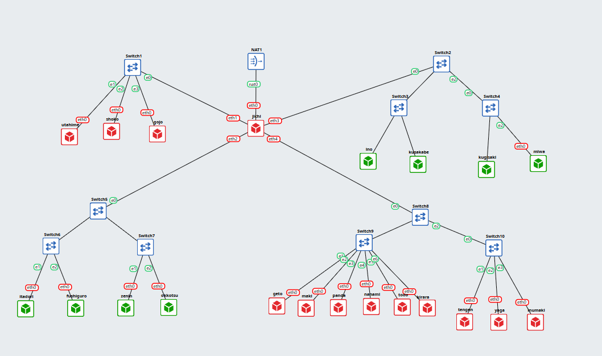

Pada topologi tersebut terdapat 1 router (jichi) dan 4 zona jaringan yang terdiri dari Network 1, Network 2, Network 3, serta Network 4. 

Network 1 menampung DNS Master **utahime**, DNS Slave **shoko**, dan public reverse proxy **gojo**. Network 2 menampung klien divisi A yang terdiri dari **Itadori, Fushiguro, Zenin, dan Okkotsu** yang nantinya akan mendapatkan IP Address melalui DHCP. Network 3 menampung klien divisi  B yang terdiri dari **Ino, Kusakabe, kugisaki, dan Miwa**. Network 4 menampung DHCP Server **tengen**, internal load balancer **geto**, worker aplikasi: **maki, panda, nanami, todo, kirara,** dan database: **inumaki, yaga**.

Setelah membuat topologi, langkah selanjutnya adalah mengonfigurasi jichi agar eth0 memperoleh WAN dari NAT, sedangkan eth1–eth4 menjadi gateway Network 1–4. Kemdudian mengaktifkan IPv4 forwarding dan source NAT.

Konfigurasi interfaces yang digunakan adalah sebagai berikut. 
```
auto lo
iface lo inet loopback

auto eth0
iface eth0 inet dhcp
    up sysctl -w net.ipv4.ip_forward=1
    up iptables -t nat -A POSTROUTING -o eth0 -j MASQUERADE

auto eth1
iface eth1 inet static
    address 10.79.1.1
    netmask 255.255.255.0

auto eth2
iface eth2 inet static
    address 10.79.2.1
    netmask 255.255.255.0

auto eth3
iface eth3 inet static
    address 10.79.3.1
    netmask 255.255.255.0

auto eth4
iface eth4 inet static
    address 10.79.4.1
    netmask 255.255.255.0
```

Kemudian mengatur DNS resolver pada jichi agar sistem dapat menerjemahkan nama domain menjadi IP. 

```sh
echo "nameserver 192.168.122.1" > /etc/resolv.conf
```

Setelah konfigurasi interface selesai, langkah selanjutnya adalah mengaktifkan IPv4 forwarding dan mengatur aturan firewall pada jichi. Script berikut digunakan untuk memastikan paket dari Network 1 hingga Network 4 dapat diteruskan menuju jaringan luar melalui eth0.

```sh
apt update
apt install -y iptables

sysctl -w net.ipv4.ip_forward=1

iptables -t nat -C POSTROUTING -o eth0 -j MASQUERADE 2>/dev/null || \
iptables -t nat -A POSTROUTING -o eth0 -j MASQUERADE

for i in eth1 eth2 eth3 eth4; do
  iptables -C FORWARD -i $i -o eth0 -j ACCEPT 2>/dev/null || \
  iptables -A FORWARD -i $i -o eth0 -j ACCEPT
done

iptables -C FORWARD -i eth0 -m conntrack --ctstate ESTABLISHED,RELATED -j ACCEPT 2>/dev/null || \
iptables -A FORWARD -i eth0 -m conntrack --ctstate ESTABLISHED,RELATED -j ACCEPT
```

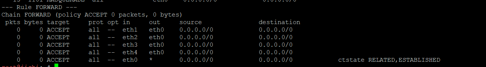

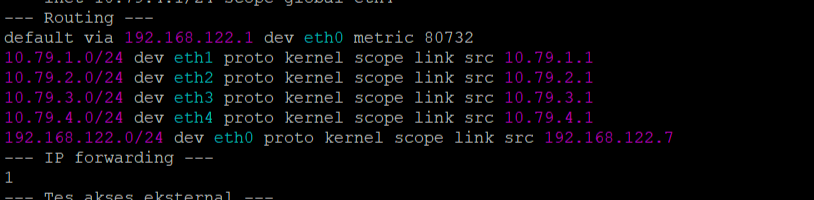

Setelah Jichi selesai dikonfigurasi, langkah selanjutnya adalah menetapkan IP statis untuk setiap host infrastruktur. 

Untuk Utahime [Network 1]
```
auto lo
iface lo inet loopback

auto eth0
iface eth0 inet static
    address 10.79.1.2
    netmask 255.255.255.0
    gateway 10.79.1.1
```

Untuk Shoko [Network 1]
```
auto lo
iface lo inet loopback

auto eth0
iface eth0 inet static
    address 10.79.1.3
    netmask 255.255.255.0
    gateway 10.79.1.1
```

Untuk Gojo [Network 1]
```
auto lo
iface lo inet loopback

auto eth0
iface eth0 inet static
    address 10.79.1.4
    netmask 255.255.255.0
    gateway 10.79.1.1
```

Untuk Tengen
```
auto lo
iface lo inet loopback

auto eth0
iface eth0 inet static
    address 10.79.4.10
    netmask 255.255.255.0
    gateway 10.79.4.1
```

Untuk Geto
```
auto lo
iface lo inet loopback

auto eth0
iface eth0 inet static
    address 10.79.4.3
    netmask 255.255.255.0
    gateway 10.79.4.1
```

Untuk Maki
```
auto lo
iface lo inet loopback

auto eth0
iface eth0 inet static
    address 10.79.4.4
    netmask 255.255.255.0
    gateway 10.79.4.1
```

Untuk Panda
```
auto lo
iface lo inet loopback

auto eth0
iface eth0 inet static
    address 10.79.4.5
    netmask 255.255.255.0
    gateway 10.79.4.1
```

Untuk Nanami 
```
auto lo
iface lo inet loopback

auto eth0
iface eth0 inet static
    address 10.79.4.6
    netmask 255.255.255.0
    gateway 10.79.4.1
```

Untuk Todo
```
auto lo
iface lo inet loopback

auto eth0
iface eth0 inet static
    address 10.79.4.7
    netmask 255.255.255.0
    gateway 10.79.4.1
```

Untuk Kirara
```
auto lo
iface lo inet loopback

auto eth0
iface eth0 inet static
    address 10.79.4.8
    netmask 255.255.255.0
    gateway 10.79.4.1
```

Untuk Yaga
```
auto lo
iface lo inet loopback

auto eth0
iface eth0 inet static
    address 10.79.4.9
    netmask 255.255.255.0
    gateway 10.79.4.1
```

Untuk Inumaki 
```
auto lo
iface lo inet loopback

auto eth0
iface eth0 inet static
    address 10.79.4.2
    netmask 255.255.255.0
    gateway 10.79.4.1
```

Kemudian untuk seluruh klien baik divisi A maupun divisi B dikonfigurasi sebagai berikut.
```
auto lo
iface lo inet loopback

auto eth0
iface eth0 inet dhcp
```

Setelah semua host dan klien selesai dikonfigurasi, selanjutnya membuktikan konektivitas setiap host ke gateway dan akses eksternal dari host yang relevan.

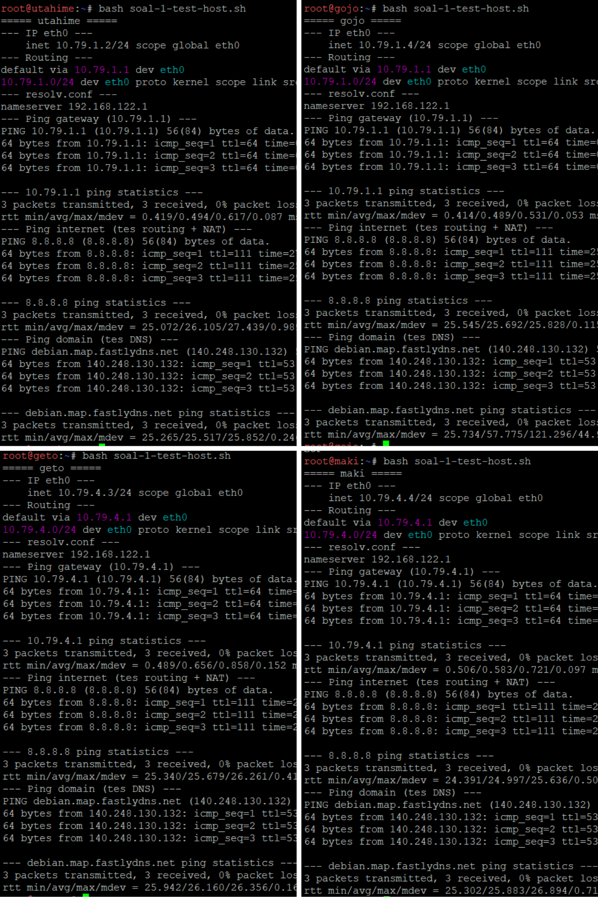

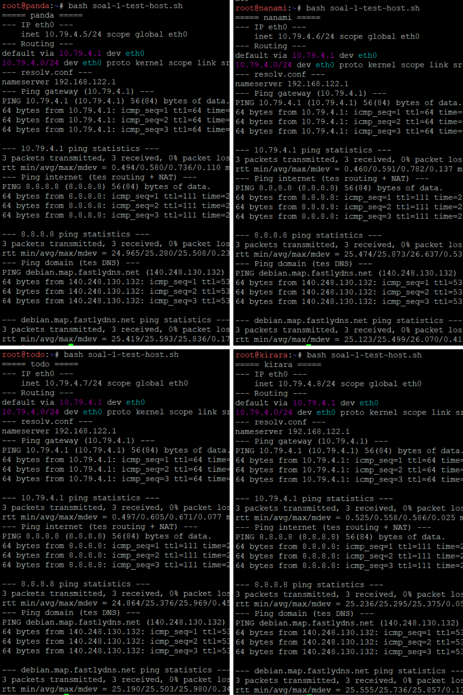

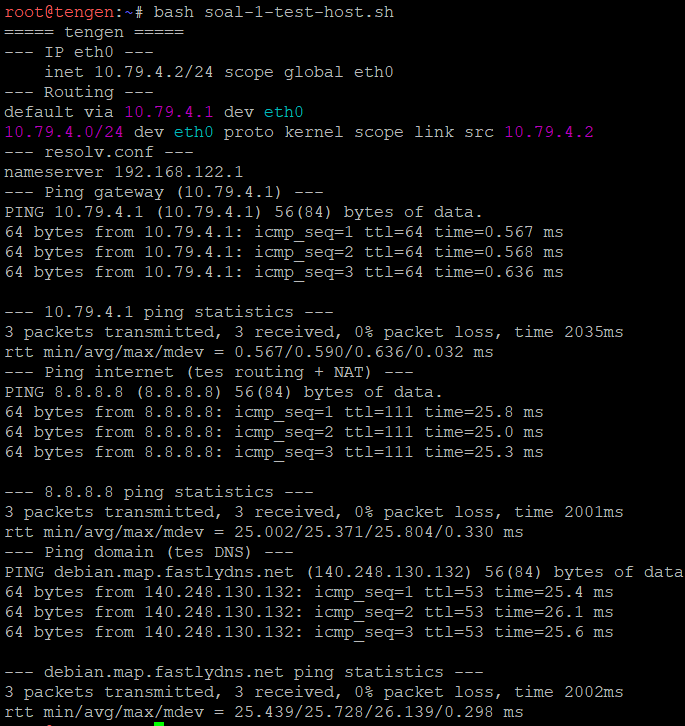

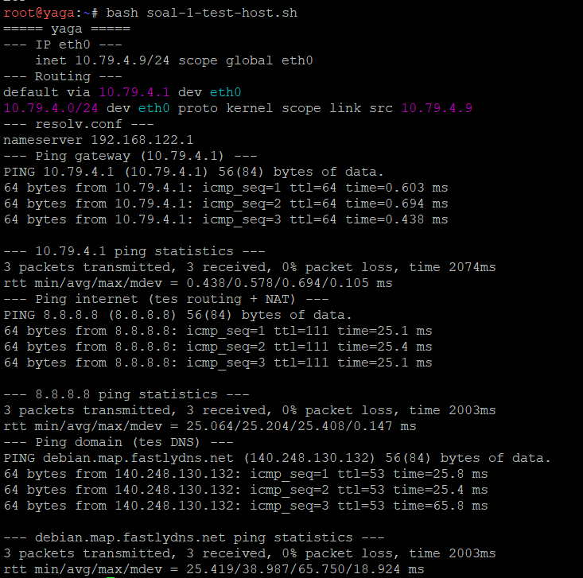

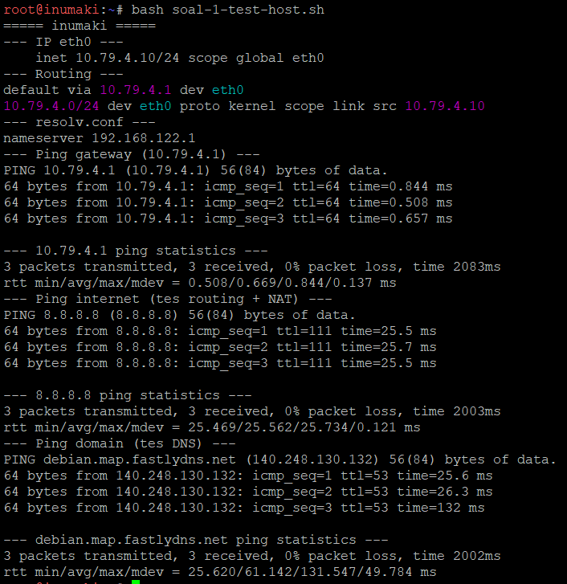

**2. Tengen, penjaga pusat distribusi di Data Center, harus mengambil alih pengalokasian alamat bagi wilayah yang membutuhkan konfigurasi dinamis. Konfigurasikan isc-dhcp-server pada [PREFIX IP].4.10. Deklarasikan Network 4 ([PREFIX IP].4.0/24) sebagai subnet lokal tanpa pool dinamis, lalu siapkan scope DHCP untuk Network 2 ([PREFIX IP].2.0/24) dan Network 3 ([PREFIX IP].3.0/24). Validasi konfigurasi dan pastikan service aktif tanpa error “No subnet declaration”.**

Pada soal ini tengen dijadikan DHCP server untuk wilayah yang membutuhkan konfigurasi dinamis, yaitu Network 2 dan Network 3. Tengen berada di Network 4 dengan IP 10.79.4.10, sehingga klien di Network 2 dan 3 tidak satu broadcast domain dengannya. Permintaan mereka nantinya diteruskan oleh relay di jichi, dan tengen memilih scope berdasarkan field giaddr yang berisi IP interface relay (10.79.2.1 atau 10.79.3.1).

Pertam tama dibuat script `konfigurasi-tengen.sh` Script ini memasang isc-dhcp-server, membatasi dhcpd agar hanya mendengarkan di eth0, lalu menulis konfigurasi. Konfigurasi dipecah menjadi beberapa file yang dipanggil lewat include, supaya script pada nomor berikutnya hanya menimpa file miliknya sendiri dan tidak merusak hasil nomor sebelumnya.

```sh
#!/bin/sh
apt update
apt install -y isc-dhcp-server

sed -i 's/^INTERFACESv4=.*/INTERFACESv4="eth0"/' /etc/default/isc-dhcp-server
mkdir -p /etc/dhcp/conf.d

cat > /etc/dhcp/dhcpd.conf <<CONF
authoritative;
default-lease-time 600;
max-lease-time 7200;

include "/etc/dhcp/conf.d/classes.conf";
include "/etc/dhcp/conf.d/net4.conf";
include "/etc/dhcp/conf.d/net2.conf";
include "/etc/dhcp/conf.d/net3.conf";
CONF

touch /etc/dhcp/conf.d/classes.conf

cat > /etc/dhcp/conf.d/net4.conf <<CONF
# Network 4 - subnet lokal
subnet 10.79.4.0 netmask 255.255.255.0 {
    option routers 10.79.4.1;
}
CONF

cat > /etc/dhcp/conf.d/net2.conf <<CONF
# Network 2 - scope DHCP
subnet 10.79.2.0 netmask 255.255.255.0 {
    range 10.79.2.10 10.79.2.200;
    option routers 10.79.2.1;
    option broadcast-address 10.79.2.255;
    option domain-name-servers 192.168.122.1;
}
CONF

cat > /etc/dhcp/conf.d/net3.conf <<CONF
# Network 3 - scope DHCP
subnet 10.79.3.0 netmask 255.255.255.0 {
    range 10.79.3.10 10.79.3.200;
    option routers 10.79.3.1;
    option broadcast-address 10.79.3.255;
    option domain-name-servers 192.168.122.1;
}
CONF

dhcpd -t -cf /etc/dhcp/dhcpd.conf && echo "done"
service isc-dhcp-server restart
```

Pertama-tama tengen diarahkan ke nameserver 192.168.122.1 agar dapat me-resolve nama repositori, lalu daftar paket diperbarui dan paket DHCP server diunduh dengan perintah berikut.

```sh
echo "nameserver 192.168.122.1" > /etc/resolv.conf
apt update
apt install -y isc-dhcp-server
```

Kemudian, apabila paket sudah terpasang, selanjutnya interface yang didengarkan oleh dhcpd diatur. File `/etc/default/isc-dhcp-server` diubah sehingga INTERFACESv4 bernilai eth0. Dengan begitu dhcpd hanya mendengarkan pada eth0 yang berada di Network 4. Setelah itu dibuat `folder /etc/dhcp/conf.d` untuk menampung file konfigurasi yang dipisah per bagian.

```sh
sed -i 's/^INTERFACESv4=.*/INTERFACESv4="eth0"/' /etc/default/isc-dhcp-server
mkdir -p /etc/dhcp/conf.d
```

Selanjutnya file utama `/etc/dhcp/dhcpd.conf` ditulis. Isinya pengaturan global, yaitu authoritative agar tengen menjadi server resmi bagi subnet yang dilayani, lease standar 600 detik, dan lease maksimum 7200 detik. Setelah itu ditambahkan baris include yang memanggil file class, subnet Network 4, Network 2, dan Network 3. 

```sh
cat > /etc/dhcp/dhcpd.conf <<CONF
authoritative;
default-lease-time 600;
max-lease-time 7200;

include "/etc/dhcp/conf.d/classes.conf";
include "/etc/dhcp/conf.d/net4.conf";
include "/etc/dhcp/conf.d/net2.conf";
include "/etc/dhcp/conf.d/net3.conf";
CONF
```

Setelah itu subnet Network 4 dideklarasikan pada net4.conf. Eth0 tengen berada di 10.79.4.0/24, dan dhcpd hanya mau berjalan bila alamat interface-nya masuk ke salah satu blok subnet. Tanpa deklarasi ini akan muncul error No subnet declaration for eth0. Subnet ini sengaja tidak diberi baris range, sehingga tidak ada alamat yang dibagikan di Network 4, dan hanya option routers yang dicantumkan.

```sh
cat > /etc/dhcp/conf.d/net4.conf <<CONF
subnet 10.79.4.0 netmask 255.255.255.0 {
    option routers 10.79.4.1;
}
CONF
```

Kemudian scope DHCP untuk Network 2 dan Network 3 disiapkan pada net2.conf dan net3.conf. Masing-masing berisi rentang alamat yang boleh dibagikan (range), gateway (option routers) yang mengarah ke jichi, alamat broadcast subnet, dan DNS yang dikirim ke klien. Klien kedua network ini tidak satu broadcast domain dengan tengen, sehingga permintaan mereka diteruskan relay jichi, dan tengen memilih scope yang sesuai berdasarkan giaddr, yaitu 10.79.2.1 atau 10.79.3.1.

```sh
cat > /etc/dhcp/conf.d/net2.conf <<CONF
subnet 10.79.2.0 netmask 255.255.255.0 {
    range 10.79.2.10 10.79.2.200;
    option routers 10.79.2.1;
    option broadcast-address 10.79.2.255;
    option domain-name-servers 192.168.122.1;
}
CONF

cat > /etc/dhcp/conf.d/net3.conf <<CONF
subnet 10.79.3.0 netmask 255.255.255.0 {
    range 10.79.3.10 10.79.3.200;
    option routers 10.79.3.1;
    option broadcast-address 10.79.3.255;
    option domain-name-servers 192.168.122.1;
}
CONF
```

Selanjutnya, konfigurasi diuji sintaksnya dengan dhcpd -t, dan teks done hanya muncul bila pengujian lolos. Apabila lolos, service dijalankan ulang agar dhcpd membaca konfigurasi yang baru.

```sh
dhcpd -t -cf /etc/dhcp/dhcpd.conf && echo "done"
service isc-dhcp-server restart
```

Terakhir, konfigurasi tersebut divalidasi dan service diperiksa.

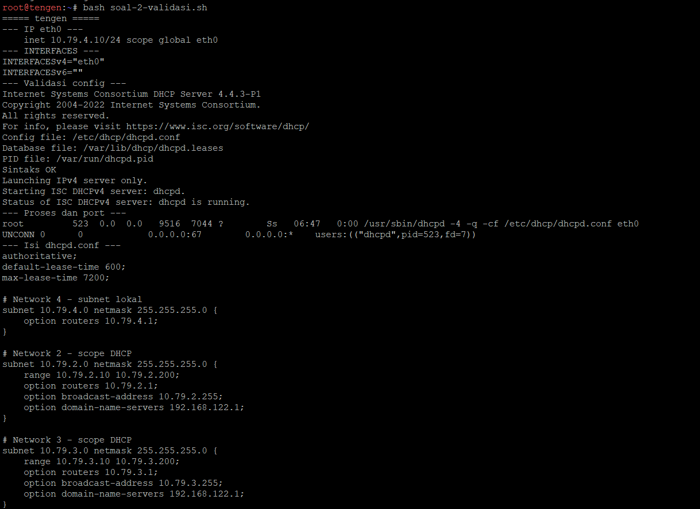

Dari gambar tersebut terlihat dhcpd -t selesai tanpa error, status service dhcpd is running dan proses dhcpd -4 ... eth0 berjalan.

**3. Permintaan alamat dari Divisi A dan Divisi B tidak dapat menyeberangi subnet secara langsung. Konfigurasikan jichi sebagai DHCP Relay menuju tengen ([PREFIX IP].4.10), menggunakan eth2 untuk Network 2 dan eth3 untuk Network 3. Buktikan bahwa client dari kedua subnet berhasil memperoleh lease melalui relay.**

Pertama-tama dibuat script `konfigurasi-dhcp-relay.sh`. 

Script ini memperbarui daftar paket, kemudian memasang paket isc-dhcp-relay. 

```sh
apt update
DEBIAN_FRONTEND=noninteractive apt install -y isc-dhcp-relay
```

Kemudian, apabila paket sudah terpasang, selanjutnya file `/etc/default/isc-dhcp-relay` ditulis. SERVERS berisi alamat DHCP server tujuan, yaitu tengen. INTERFACES berisi eth2 dan eth3 sebagai sisi klien yang menerima Discover. Selain itu eth4 juga dicantumkan karena relay memerlukannya sebagai jalur ke tengen dan untuk menerima balasan dari tengen.

```sh
cat > /etc/default/isc-dhcp-relay <<CONF
SERVERS="10.79.4.10"
INTERFACES="eth2 eth3 eth4"
OPTIONS=""
CONF
```

Selanjutnya service relay dijalankan ulang agar membaca konfigurasi baru, lalu statusnya diperiksa.

```sh
service isc-dhcp-relay restart
sleep 2
service isc-dhcp-relay status
```

Berikut script lengkap dari `konfigurasi-dhcp-relay.sh`.

```sh
##!/bin/sh

apt update
DEBIAN_FRONTEND=noninteractive apt install -y isc-dhcp-relay

cat > /etc/default/isc-dhcp-relay <<CONF
SERVERS="10.79.4.10"
INTERFACES="eth2 eth3 eth4"
OPTIONS=""
CONF

service isc-dhcp-relay restart
sleep 2
service isc-dhcp-relay status
```

Setelah script dijalankan, selanjutnya membuktikan bahwa klien dari kedua subnet memperoleh lease melalui relay. Pada setiap klien (itadori, fushiguro, zenin, okkotsu di Network 2 dan ino, kusakabe, miwa, kugisaki di Network 3) dijalankan script berikut. 

```sh
#!/bin/sh

echo "===== $(hostname) ====="
udhcpc -i eth0 -n -q
echo "--- IP eth0 ---"
ip -4 a show eth0 | grep inet
echo "--- Route ---"
ip route
echo "--- DNS ---"
cat /etc/resolv.conf
GW=$(ip route | awk '/^default/ {print $3}')
echo "--- Ping gateway ($GW) ---"
ping -c 3 $GW
```

Berikut hasil pengujian untuk salah satu klien di Network 2 yaitu Itadori.

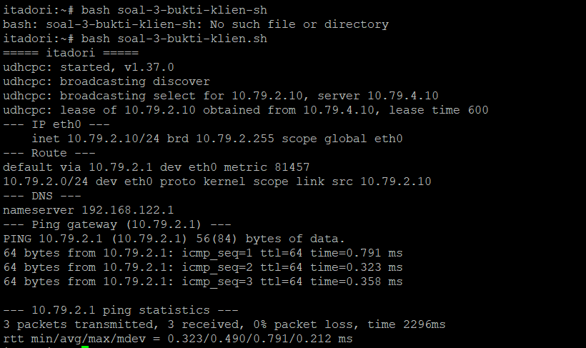

Dari gambar tersebut terlihat klien Network 2 memperoleh alamat 10.79.2.10/24 dengan gateway 10.79.2.1, dan pada baris udhcpc tertulis lease of 10.79.2.10 obtained from 10.79.4.10. Server yang menjawab adalah tengen (10.79.4.10), sehingga terbukti permintaan diteruskan oleh relay.

Kemudian untuk klien di Network 3 yang diuji adalah Ino.

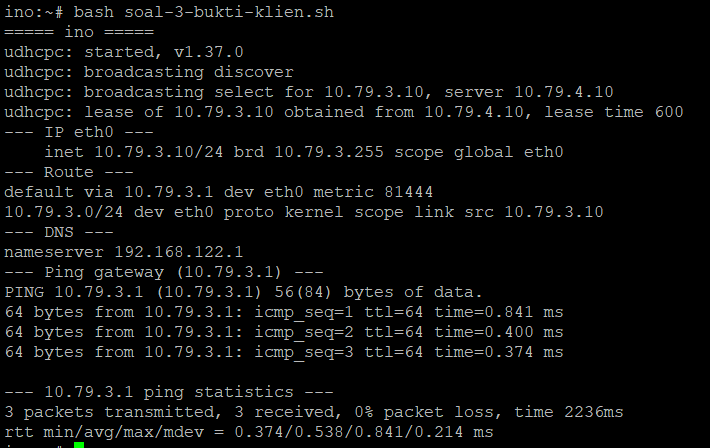

Dari gambar tersebut terlihat klien Network 3 memperoleh alamat 10.79.3.10/24 dengan gateway 10.79.3.1, dan lease juga diperoleh dari 10.79.4.10.

**4. Agar tim Dev dan Support di Divisi A menerima jatah alamat yang berbeda, atur dua pool DHCP pada Network 2. Tetapkan Pool 1 ([PREFIX IP].2.10–[PREFIX IP].2.35) untuk itadori dan fushiguro, serta Pool 2 ([PREFIX IP].2.70–[PREFIX IP].2.95) untuk zenin dan okkotsu. Rentang [PREFIX IP].2.36–[PREFIX IP].2.69 tidak boleh dialokasikan. Karena seluruh client berada pada subnet yang sama, gunakan DHCP class berdasarkan MAC Address atau Client ID untuk memisahkan kedua kelompok.**

Pertama-tama mencari MAC address eth0 dari keempat klien, karena nilai inilah yang menjadi dasar DHCP class. Perintah ini dijalankan di itadori, fushiguro, zenin, dan okkotsu.

```
ip link show eth0 | grep link/ether
```

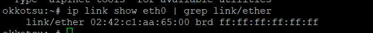

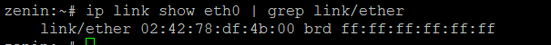

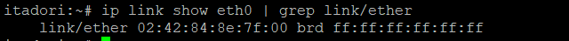

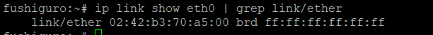

Itadori: 02:42:84:8e:7f:00 
Fushiguro: 02:42:b3:70:a5:00 
Zenin: 02:42:78:df:4b:00
Okkotsu:  02:42:c1:aa:65:00 

Kemudian membuat script `soal-4-konfigurasi-tengen.sh` di tengen. Pertama-tama, keempat MAC address klien disimpan dalam variabel di bagian atas script, supaya apabila MAC berubah, cukup nilai variabelnya yang diganti tanpa mengubah bagian lain.

sh
MAC_ITADORI="02:42:84:8e:7f:00"
MAC_FUSHIGURO="02:42:b3:70:a5:00"
MAC_ZENIN="02:42:78:df:4b:00"
MAC_OKKOTSU="02:42:c1:aa:65:00"

Selanjutnya pada file /etc/dhcp/conf.d/classes.conf dibuat dua class, yaitu pool1 dan pool2. Baris match hardware; membuat keanggotaan class ditentukan oleh MAC address klien. Setelah class terbentuk, tiap MAC didaftarkan sebagai anggota dengan subclass. Angka 1: di depan MAC menunjukkan tipe hardware Ethernet. itadori dan fushiguro masuk pool1, sedangkan zenin dan okkotsu masuk pool2.

```sh
cat > /etc/dhcp/conf.d/classes.conf <<CONF
class "pool1" {
    match hardware;
}
subclass "pool1" 1:${MAC_ITADORI};
subclass "pool1" 1:${MAC_FUSHIGURO};

class "pool2" {
    match hardware;
}
subclass "pool2" 1:${MAC_ZENIN};
subclass "pool2" 1:${MAC_OKKOTSU};
CONF
```

Kemudian, setelah class terbentuk, file /etc/dhcp/conf.d/net2.conf ditulis ulang. Pada bagian awal subnet 10.79.2.0 diatur opsi yang berlaku untuk semua klien, yaitu gateway (option routers), alamat broadcast, dan DNS yang dikirim ke klien.

```sh
cat > /etc/dhcp/conf.d/net2.conf <<CONF
subnet 10.79.2.0 netmask 255.255.255.0 {
    option routers 10.79.2.1;
    option broadcast-address 10.79.2.255;
    option domain-name-servers 192.168.122.1;
```

Selanjutnya, di dalam subnet tersebut dibuat blok pool pertama. Baris allow members of "pool1" membatasi pool ini hanya untuk anggota class pool1, sedangkan range 10.79.2.10 10.79.2.35 menentukan rentang alamat yang boleh dibagikan. Dengan begitu itadori dan fushiguro hanya akan menerima alamat dari rentang ini.

```sh
    pool {
        allow members of "pool1";
        range 10.79.2.10 10.79.2.35;
    }
```

Setelah itu blok pool kedua dibuat dengan cara yang sama untuk class pool2, dengan rentang 10.79.2.70 sampai 10.79.2.95. Rentang 10.79.2.36 sampai 10.79.2.69 tidak dicantumkan pada range mana pun, sehingga tidak pernah dialokasikan. Tanda } terakhir menutup blok subnet, dan CONF menutup penulisan file.

```sh
    pool {
        allow members of "pool2";
        range 10.79.2.70 10.79.2.95;
    }
}
CONF
```
Terakhir, sintaks konfigurasi diuji dengan dhcpd -t, dan teks Sintaks OK hanya muncul bila pengujian lolos.

```sh
dhcpd -t -cf /etc/dhcp/dhcpd.conf && echo "Sintaks OK"
```

Apabila sintaks sudah benar, service dihentikan terlebih dahulu, lalu file catatan lease dikosongkan dengan : > agar lease lama tidak tercampur dengan hasil pengujian yang baru. Setelah itu service dinyalakan kembali dan statusnya diperiksa.

```sh
service isc-dhcp-server stop
: > /var/lib/dhcp/dhcpd.leases
service isc-dhcp-server start
service isc-dhcp-server status
```
Berikut script lengkapnya, yang disimpan lalu dijalankan.

```sh
#!/bin/sh
MAC_ITADORI="02:42:84:8e:7f:00"
MAC_FUSHIGURO="02:42:b3:70:a5:00"
MAC_ZENIN="f2:dd:ec:51:c9:cb"
MAC_OKKOTSU="02:42:c1:aa:65:00"

cat > /etc/dhcp/conf.d/classes.conf <<CONF
class "pool1" {
    match hardware;
}
subclass "pool1" 1:${MAC_ITADORI};
subclass "pool1" 1:${MAC_FUSHIGURO};

class "pool2" {
    match hardware;
}
subclass "pool2" 1:${MAC_ZENIN};
subclass "pool2" 1:${MAC_OKKOTSU};
CONF

cat > /etc/dhcp/conf.d/net2.conf <<CONF
subnet 10.79.2.0 netmask 255.255.255.0 {
    option routers 10.79.2.1;
    option broadcast-address 10.79.2.255;
    option domain-name-servers 192.168.122.1;

    # Pool 1: itadori, fushiguro
    pool {
        allow members of "pool1";
        range 10.79.2.10 10.79.2.35;
    }

    # Pool 2: zenin, okkotsu
    pool {
        allow members of "pool2";
        range 10.79.2.70 10.79.2.95;
    }
}
CONF

dhcpd -t -cf /etc/dhcp/dhcpd.conf && echo "Sintaks OK"

service isc-dhcp-server stop
: > /var/lib/dhcp/dhcpd.leases
service isc-dhcp-server start
service isc-dhcp-server status
```

Selanjutnya dibuktikan bahwa tiap klien menerima alamat dari pool yang benar. Pada keempat klien dijalankan script berikut.
```sh
#!/bin/sh
echo "===== $(hostname) ====="
echo "MAC : $(ip link show eth0 | awk '/link\/ether/ {print $2}')"

ip addr flush dev eth0
udhcpc -i eth0 -n -q

echo "--- IP eth0 ---"
ip -4 a show eth0 | grep inet
echo "--- Route ---"
ip route
echo "--- DNS ---"
cat /etc/resolv.conf
GW=$(ip route | awk '/^default/ {print $3}')
if [ -n "$GW" ]; then
  echo "--- Ping gateway ($GW) ---"
  ping -c 3 $GW
else
  echo "Tidak ada default route, lease gagal"
fi
```

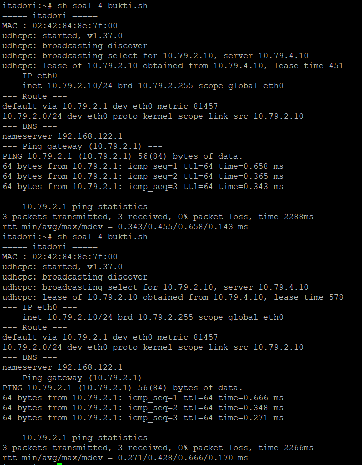

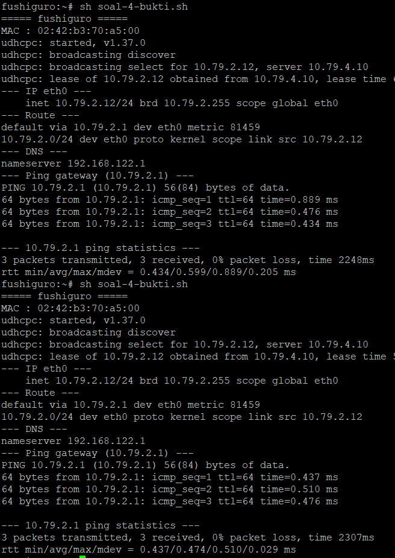

Dari gambar tersebut terlihat itadori dan fushiguro memperoleh alamat pada rentang 10.79.2.10 sampai 10.79.2.35 (Pool 1), dengan gateway 10.79.2.1.

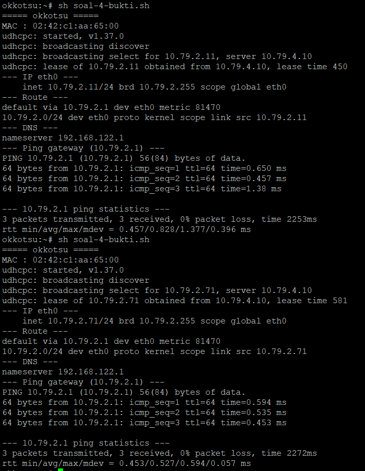

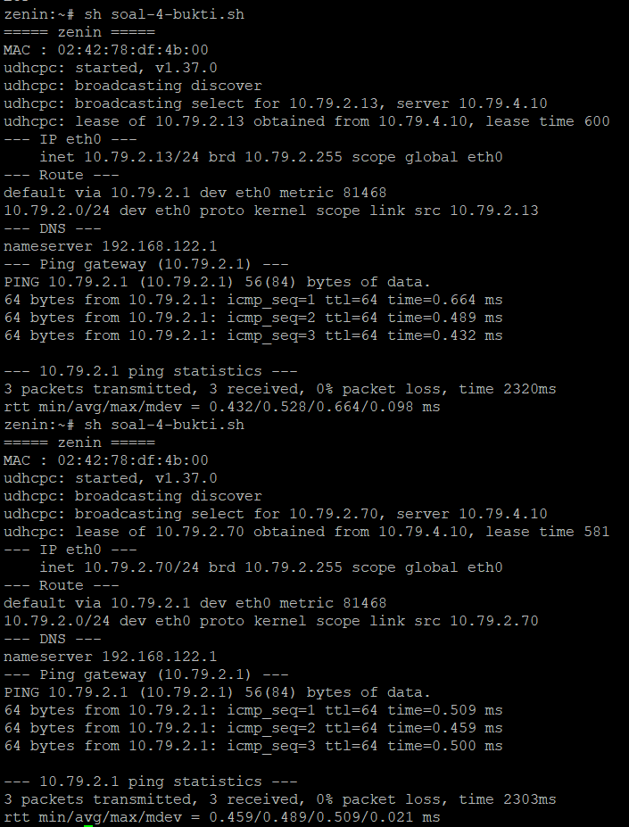

Dari gambar tersebut terlihat zenin dan okkotsu memperoleh alamat pada rentang 10.79.2.70 sampai 10.79.2.95 (Pool 2), dengan gateway yang sama.

**5. Setiap tim lapangan memiliki durasi operasi yang berbeda. Pada Network 3, berikan short lease 30 menit (1800 detik) kepada ino dan kusakabe, serta long lease 12 jam (43200 detik) kepada miwa. Gunakan pool short lease [PREFIX IP].3.10–[PREFIX IP].3.89 dan pool long lease [PREFIX IP].3.100–[PREFIX IP].3.199. Sesuaikan default-lease-time dan max-lease-time untuk setiap kelas client. Berikan pula DHCP options berupa DNS [PREFIX IP].1.2 dan [PREFIX IP].1.3, serta domain-search <xxxx>.com.**

Pertama-tama mencari MAC address eth0 dari ino, kusakabe, dan miwa. Command ini dijalankan di masing-masing klien.

```sh
ip link show eth0 | grep link/ether
```

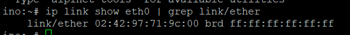

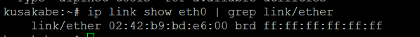

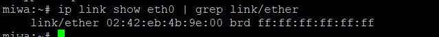

Ino:  02:42:97:71:9c:00
Kusakabe: 02:42:b9:bd:e6:00
Miwa: 02:42:eb:4b:9e:00 

Kemudian dibuat script `soal-5-konfigurasi-tengen.sh` di tengen. Pertama-tama, ketiga MAC disimpan dalam variabel di bagian atas script, supaya apabila MAC berubah cukup nilai variabelnya yang diganti.

```sh
MAC_INO="02:42:97:71:9c:00"
MAC_KUSAKABE="02:42:b9:bd:e6:00"
MAC_MIWA="02:42:eb:4b:9e:00"
```

Selanjutnya mengisi konfigurasi di file /etc/dhcp/conf.d/net3.conf, bagian pertama berisi dua class. Class short-lease beranggotakan ino dan kusakabe, sedangkan class long-lease beranggotakan miwa. Baris match hardware; membuat keanggotaan ditentukan oleh MAC klien, lalu tiap MAC didaftarkan dengan subclass. Angka 1: di depan MAC adalah tipe hardware Ethernet.

```sh
cat > /etc/dhcp/conf.d/net3.conf <<CONF
class "short-lease" {
    match hardware;
}
subclass "short-lease" 1:${MAC_INO};
subclass "short-lease" 1:${MAC_KUSAKABE};

class "long-lease" {
    match hardware;
}
subclass "long-lease" 1:${MAC_MIWA};
```

Kemudian, pada blok subnet 10.79.3.0 diatur opsi yang berlaku untuk semua klien Network 3. option routers adalah gateway (jichi eth3), option broadcast-address adalah alamat broadcast subnet, option domain-name-servers berisi DNS utahime dan shoko, dan option domain-search berisi domain pencarian K31.com. 

```sh
subnet 10.79.3.0 netmask 255.255.255.0 {
    option routers 10.79.3.1;
    option broadcast-address 10.79.3.255;
    option domain-name-servers 10.79.1.2, 10.79.1.3;
    option domain-search "K31.com";
```

Selanjutnya dibuat blok pool pertama untuk short lease. Baris allow members of "short-lease"; membatasi pool ini hanya untuk anggota class short-lease, dan range menentukan rentang alamatnya. Baris default-lease-time dan max-lease-time diatur 1800 detik sehingga durasi lease ino dan kusakabe pasti 30 menit.

```sh
    pool {
        allow members of "short-lease";
        range 10.79.3.10 10.79.3.89;
        default-lease-time 1800;
        max-lease-time 1800;
    }
```

Setelah itu blok pool kedua dibuat dengan cara yang sama untuk class long-lease, dengan rentang 10.79.3.100 sampai 10.79.3.199 dan lease time 43200 detik (12 jam). Rentang .90 sampai .99 tidak dicantumkan pada range mana pun, sehingga alamat 10.79.3.99 aman dipakai untuk fixed address kugisaki. Tanda } terakhir menutup blok subnet, dan CONF menutup penulisan file.

```sh
    pool {
        allow members of "long-lease";
        range 10.79.3.100 10.79.3.199;
        default-lease-time 43200;
        max-lease-time 43200;
    }
}
CONF
```

Terakhir, sintaks konfigurasi diuji dengan dhcpd -t. Apabila lolos, service dihentikan, file catatan lease dikosongkan dengan : > agar lease lama tidak tercampur dengan hasil pengujian, lalu service dinyalakan kembali dan statusnya diperiksa.

```sh
dhcpd -t -cf /etc/dhcp/dhcpd.conf && echo "Sintaks OK"

service isc-dhcp-server stop
: > /var/lib/dhcp/dhcpd.leases
service isc-dhcp-server start
service isc-dhcp-server status
```
Berikut script lengkapnya, yang disimpan lalu dijalankan.

```sh
#!/bin/sh
MAC_INO="02:42:97:71:9c:00"
MAC_KUSAKABE="02:42:b9:bd:e6:00"
MAC_MIWA="02:42:eb:4b:9e:00"

cat > /etc/dhcp/conf.d/net3.conf <<CONF
# Class berdasarkan MAC address (Network 3)
class "short-lease" {
    match hardware;
}
subclass "short-lease" 1:${MAC_INO};
subclass "short-lease" 1:${MAC_KUSAKABE};

class "long-lease" {
    match hardware;
}
subclass "long-lease" 1:${MAC_MIWA};

# Network 3
subnet 10.79.3.0 netmask 255.255.255.0 {
    option routers 10.79.3.1;
    option broadcast-address 10.79.3.255;
    option domain-name-servers 10.79.1.2, 10.79.1.3;
    option domain-search "K31.com";

    # Short lease: ino, kusakabe (30 menit)
    pool {
        allow members of "short-lease";
        range 10.79.3.10 10.79.3.89;
        default-lease-time 1800;
        max-lease-time 1800;
    }

    # Long lease: miwa (12 jam)
    pool {
        allow members of "long-lease";
        range 10.79.3.100 10.79.3.199;
        default-lease-time 43200;
        max-lease-time 43200;
    }
}
CONF

dhcpd -t -cf /etc/dhcp/dhcpd.conf && echo "Sintaks OK"

service isc-dhcp-server stop
: > /var/lib/dhcp/dhcpd.leases
service isc-dhcp-server start
service isc-dhcp-server status
```

Setelah script dijalankan, selanjutnya dibuktikan bahwa tiap klien menerima alamat dan lease time yang benar. Pada ino, kusakabe, dan miwa dijalankan script berikut. 
```sh
#!/bin/sh
echo "===== $(hostname) ====="
echo "MAC : $(ip link show eth0 | awk '/link\/ether/ {print $2}')"

ip addr flush dev eth0
udhcpc -i eth0 -n -q

echo "--- IP eth0 ---"
ip -4 a show eth0 | grep inet
echo "--- Route ---"
ip route
echo "--- DNS ---"
cat /etc/resolv.conf
GW=$(ip route | awk '/^default/ {print $3}')
if [ -n "$GW" ]; then
  echo "--- Ping gateway ($GW) ---"
  ping -c 3 $GW
else
  echo "Tidak ada default route, lease gagal"
fi
```

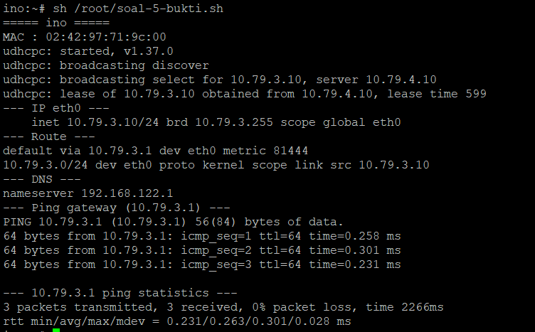

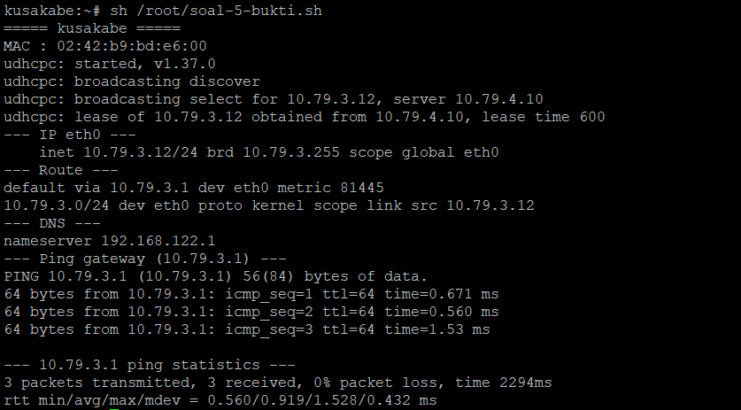

Dari gambar tersebut terlihat ino dan kusakabe memperoleh alamat pada rentang 10.79.3.10 sampai 10.79.3.89, dengan baris lease time 1800, gateway 10.79.3.1, serta DNS 10.79.1.2 dan 10.79.1.3.

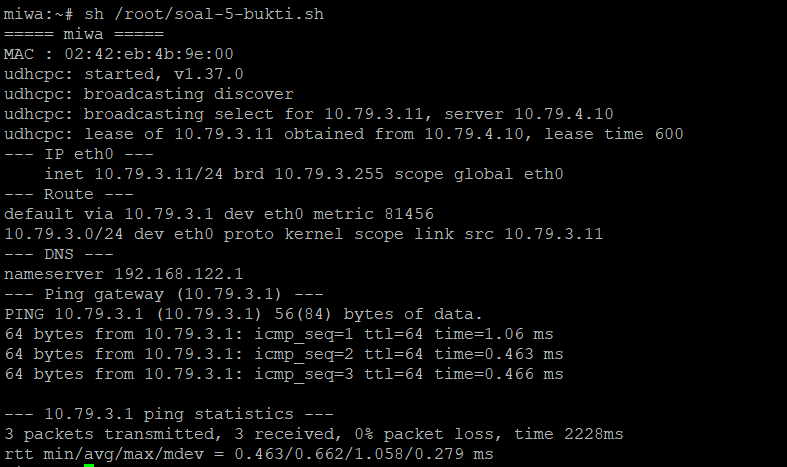

Dari gambar tersebut terlihat miwa memperoleh alamat pada rentang 10.79.3.100 sampai 10.79.3.199, dengan baris lease time 43200.

Setelah itu kita bisa melakukan pengecekan dengan command berikut ini di node tengen (Server DHCP).

```sh
tail -40 /var/lib/dhcp/dhcpd.leases
```

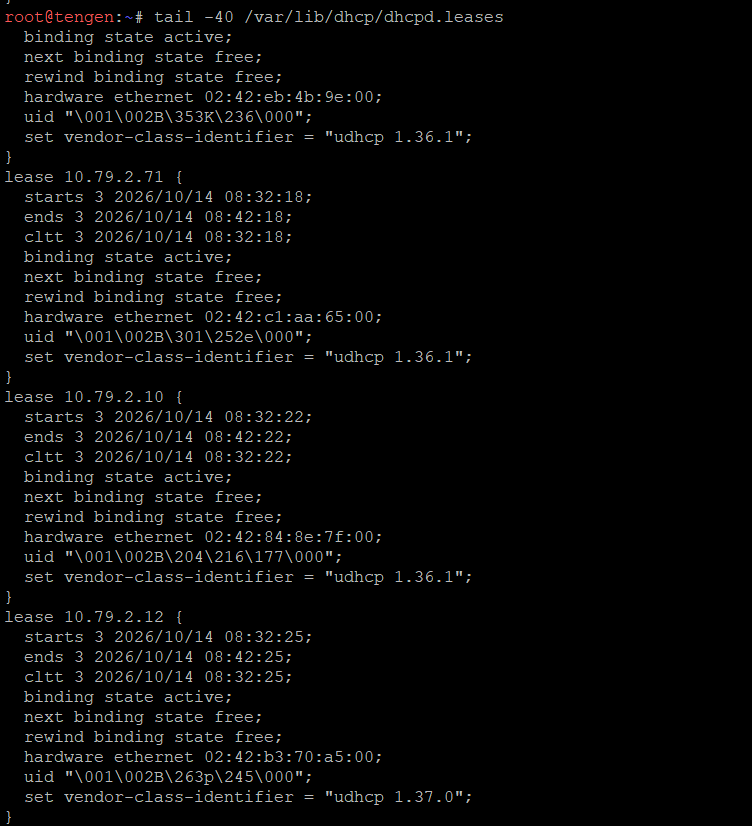

Dari gambar tersebut terlihat lease ino dan kusakabe berselisih 30 menit antara starts dan ends, sedangkan lease miwa berselisih 12 jam. 

**6. Kugisaki ditetapkan sebagai personel VIP yang harus mempertahankan alamat yang sama setiap kali terhubung. Buat DHCP static lease berdasarkan MAC Address client tersebut dengan fixed address [PREFIX IP].3.99. Pastikan alamat ini berada di luar seluruh pool dinamis, validasi konfigurasi server, lalu renew lease pada client. Buktikan bahwa alamat yang diterima sesuai dengan reservasi.**

Pertama-tama mencari MAC address eth0 dari Kugisaki. Berikut command yang dijalankan.

```sh
ip link show eth0 | grep link/ether
```

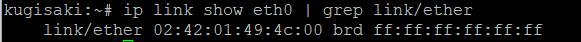

MAC Address Kugisaki: 02:42:01:49:4c:00

Kemudian dibuat script `soal-6-konfigurasi-tengen.sh` di tengen. Pertama-tama, MAC dan alamat tetap disimpan dalam variabel di bagian atas script, supaya apabila MAC berubah cukup nilai variabelnya yang diganti.

```sh
MAC_KUGISAKI="02:42:01:49:4c:00"
IP_KUGISAKI="10.79.3.99"
```

Selanjutnya mengisi file /etc/dhcp/conf.d/hosts.conf, pada blok host kugisaki berisi hardware ethernet, yaitu MAC yang dikenali server, dan fixed-address, yaitu alamat yang selalu diberikan kepada MAC tersebut. Dengan begitu kugisaki selalu menerima 10.79.3.99 setiap meminta lease.

```sh
cat > /etc/dhcp/conf.d/hosts.conf <<CONF
host kugisaki {
    hardware ethernet ${MAC_KUGISAKI};
    fixed-address ${IP_KUGISAKI};
}
CONF
```

Setelah itu file hosts.conf perlu dipanggil dari dhcpd.conf lewat baris include. Perintah grep -q memeriksa apakah baris tersebut sudah ada. Apabila belum ada (||), baris include ditambahkan di akhir dhcpd.conf dengan >>. Pengecekan ini mencegah baris tertulis dua kali bila script dijalankan ulang.

```sh
grep -q 'conf.d/hosts.conf' /etc/dhcp/dhcpd.conf || \
echo 'include "/etc/dhcp/conf.d/hosts.conf";' >> /etc/dhcp/dhcpd.conf
```

Kemudian sintaks konfigurasi diuji dengan dhcpd -t, dan teks Sintaks OK hanya muncul bila pengujian lolos.

```sh
echo "--- validasi ---"
dhcpd -t -cf /etc/dhcp/dhcpd.conf && echo "Sintaks OK"
```

Selanjutnya ditampilkan seluruh range pada net3.conf untuk membuktikan bahwa 10.79.3.99 tidak termasuk pool mana pun. Hasilnya hanya 10.79.3.10 10.79.3.89 dan 10.79.3.100 10.79.3.199, sehingga .99 jatuh di celah di antara keduanya.

```sh
echo "--- cek di luar pool ---"
grep -n "range" /etc/dhcp/conf.d/net3.conf
```

Terakhir, service dijalankan ulang agar membaca reservasi baru. Jeda 2 detik (sleep 2) diberikan supaya service sempat naik sebelum statusnya diperiksa.

```sh
service isc-dhcp-server restart
sleep 2
service isc-dhcp-server status
```

Berikut script lengkapnya, yang disimpan lalu dijalankan.

```sh
#!/bin/sh
MAC_KUGISAKI="02:42:01:49:4c:00"
IP_KUGISAKI="10.79.3.99"

cat > /etc/dhcp/conf.d/hosts.conf <<CONF
host kugisaki {
    hardware ethernet ${MAC_KUGISAKI};
    fixed-address ${IP_KUGISAKI};
}
CONF

grep -q 'conf.d/hosts.conf' /etc/dhcp/dhcpd.conf || \
echo 'include "/etc/dhcp/conf.d/hosts.conf";' >> /etc/dhcp/dhcpd.conf

echo "--- validasi ---"
dhcpd -t -cf /etc/dhcp/dhcpd.conf && echo "Sintaks OK"

echo "--- cek di luar pool ---"
grep -n "range" /etc/dhcp/conf.d/net3.conf

service isc-dhcp-server restart
sleep 2
service isc-dhcp-server status
```

Setelah menjalankan script di atas, selanjutnya dilakukan permintaan lease pada kugisaki. Script berikut dijalankan di kugisaki. Script melepas IP lama, meminta lease baru, lalu mencetak hasilnya. Script dijalankan dua kali untuk menunjukkan bahwa alamat yang diterima selalu sama.

```sh
#!/bin/sh
echo "===== $(hostname) ====="
echo "MAC : $(ip link show eth0 | awk '/link\/ether/ {print $2}')"

ip addr flush dev eth0
udhcpc -i eth0 -n -q

echo "--- IP eth0 ---"
ip -4 a show eth0 | grep inet
echo "--- Route ---"
ip route
echo "--- DNS ---"
cat /etc/resolv.conf
GW=$(ip route | awk '/^default/ {print $3}')
if [ -n "$GW" ]; then
  echo "--- Ping gateway ($GW) ---"
  ping -c 3 $GW
else
  echo "Tidak ada default route, lease gagal"
fi
```

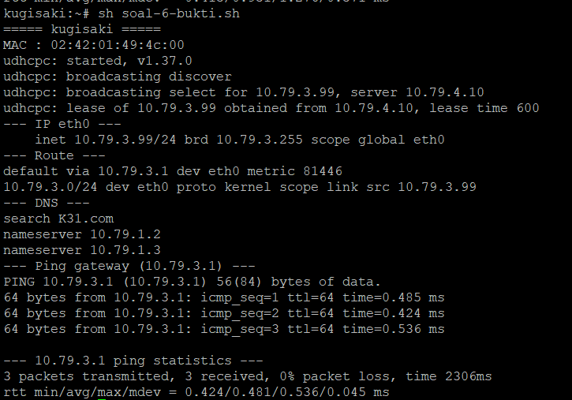

Dari gambar tersebut terlihat pada baris udhcpc tertulis lease of 10.79.3.99 obtained from 10.79.4.10, dan ip -4 a show eth0 menampilkan inet 10.79.3.99/24. Gateway 10.79.3.1 dan DNS 10.79.1.2 serta 10.79.1.3 juga diterima, dan ping ke gateway berhasil.

**7. Setelah aturan alokasi diterapkan, pastikan setiap client menerima konfigurasi jaringan sesuai wilayahnya: subnet mask 255.255.255.0 (/24), gateway dan broadcast address yang benar, DNS [PREFIX IP].1.2 serta [PREFIX IP].1.3, dan domain-search yang ditentukan. Periksa IP address dan routing seluruh client Divisi A dan Divisi B, kemudian cocokkan lease dengan /var/lib/dhcp/dhcpd.leases pada tengen. Pastikan tidak ada alamat yang bertabrakan atau berada di luar kebijakan pool.**

Pertama-tama, opsi DNS dan domain lama pada net2.conf dihapus dengan sed, supaya tidak ada opsi yang tertulis dua kali. Perintah d pada sed menghapus baris yang cocok dengan pola.

```sh
sed -i '/option domain-name-servers/d;/option domain-search/d;/option domain-name /d' /etc/dhcp/conf.d/net2.conf
```

Selanjutnya opsi yang benar ditambahkan tepat setelah baris option routers. Perintah a pada sed menambahkan teks setelah baris yang cocok. Opsi domain-name ditambahkan di samping domain-search karena klien Alpine (udhcpc) menuliskan baris search di resolv.conf dari opsi tersebut. Pool dan class pada net2.conf tidak tersentuh.

```sh
sed -i '/option routers/a\    option domain-name-servers 10.79.1.2, 10.79.1.3;\n    option domain-search "K31.com";\n    option domain-name "K31.com";' /etc/dhcp/conf.d/net2.conf
```

Kemudian sintaks diuji dengan dhcpd -t, lalu seluruh opsi jaringan pada kedua subnet ditampilkan dengan grep untuk memastikan keduanya konsisten.

```sh
dhcpd -t -cf /etc/dhcp/dhcpd.conf && echo "Sintaks OK"
grep -nE "subnet|routers|broadcast|domain" /etc/dhcp/conf.d/net2.conf /etc/dhcp/conf.d/net3.conf
```
Terakhir, service dijalankan ulang agar membaca konfigurasi baru, dan statusnya diperiksa.

```sh
service isc-dhcp-server restart
sleep 2
service isc-dhcp-server status
```

Selanjutnya setiap klien meminta lease ulang agar menerima opsi yang baru. Pada kedelapan klien (itadori, fushiguro, zenin, okkotsu, ino, kusakabe, miwa, dan kugisaki) dijalankan script berikut.

```sh
#!/bin/sh
echo "===== $(hostname) ====="
echo "MAC : $(ip link show eth0 | awk '/link\/ether/ {print $2}')"

ip addr flush dev eth0
udhcpc -i eth0 -n -q

echo "--- IP eth0 ---"
ip -4 a show eth0 | grep inet
echo "--- Route ---"
ip route
echo "--- DNS ---"
cat /etc/resolv.conf
GW=$(ip route | awk '/^default/ {print $3}')
if [ -n "$GW" ]; then
  echo "--- Ping gateway ($GW) ---"
  ping -c 3 $GW
else
  echo "Tidak ada default route, lease gagal"
fi
```
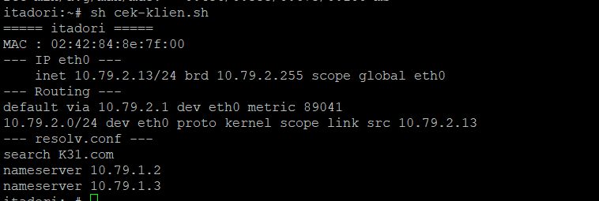

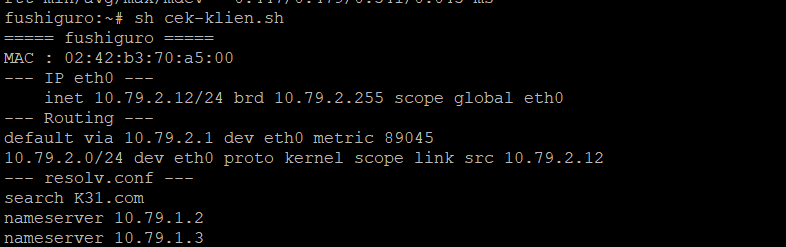

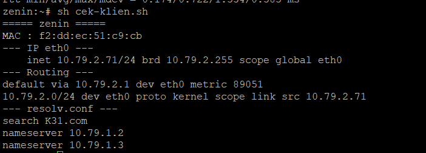

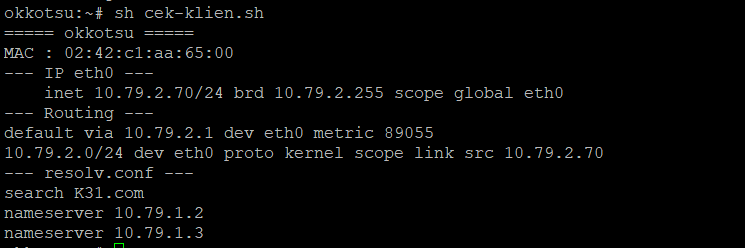

Dari gambar tersebut terlihat klien Divisi A (itadori, fushiguro, zenin, okkotsu) memperoleh alamat 10.79.2.x/24 dengan brd 10.79.2.255, default via 10.79.2.1, serta resolv.conf berisi search K31.com, nameserver 10.79.1.2, dan nameserver 10.79.1.3. Alamat itadori dan fushiguro berada di rentang .10 sampai .35, sedangkan zenin dan okkotsu di rentang .70 sampai .95.

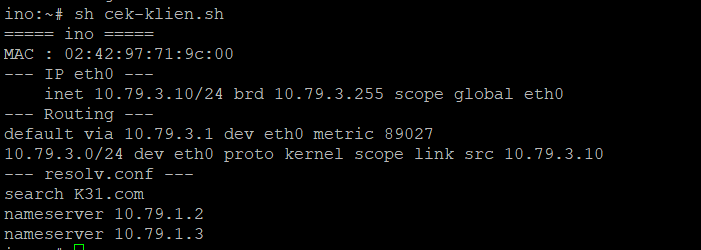

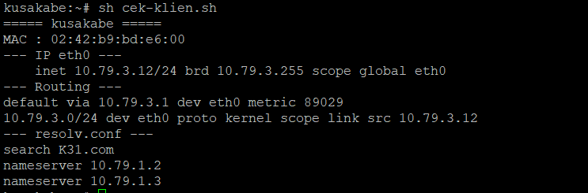

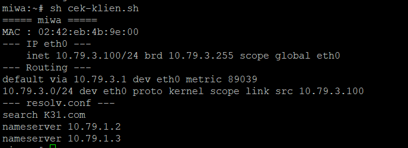

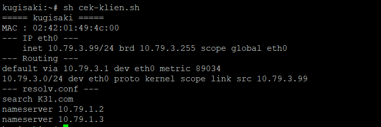

Dari gambar tersebut terlihat klien Divisi B (ino, kusakabe, miwa, kugisaki) memperoleh alamat 10.79.3.x/24 dengan brd 10.79.3.255, default via 10.79.3.1, dan DNS serta domain-search yang sama. Ino dan kusakabe berada di rentang .10 sampai .89, miwa di rentang .100 sampai .199, dan kugisaki tepat 10.79.3.99.

Selanjutnya hasil pada klien dicocokkan dengan catatan lease di tengen. Script berikut membaca dhcpd.leases, mengambil status terakhir tiap alamat, lalu membandingkan setiap MAC dengan rentang pool yang diizinkan. Alamat yang berada di luar kebijakan ditandai DI LUAR POOL, MAC yang tidak dikenal ditandai TIDAK DIKENAL, dan MAC yang memegang lebih dari satu alamat aktif diberi peringatan.

```sh
#!/bin/sh
LEASES=/var/lib/dhcp/dhcpd.leases

awk '
BEGIN {
  pol["02:42:84:8e:7f:00"]="itadori 10.79.2. 10 35"
  pol["02:42:b3:70:a5:00"]="fushiguro 10.79.2. 10 35"
  pol["f2:dd:ec:51:c9:cb"]="zenin 10.79.2. 70 95"
  pol["02:42:c1:aa:65:00"]="okkotsu 10.79.2. 70 95"
  pol["02:42:97:71:9c:00"]="ino 10.79.3. 10 89"
  pol["02:42:b9:bd:e6:00"]="kusakabe 10.79.3. 10 89"
  pol["02:42:eb:4b:9e:00"]="miwa 10.79.3. 100 199"
  pol["02:42:01:49:4c:00"]="kugisaki 10.79.3. 99 99"
}
/^lease /      { ip=$2 }
$1=="binding"  { st=$3; sub(";","",st) }
$1=="hardware" { mac=$3; sub(";","",mac) }
$1=="ends"     { ends=$3" "$4; sub(";","",ends) }
/^}/           { state[ip]=st; macof[ip]=mac; endof[ip]=ends }
END {
  print "IP               MAC                NAMA        ENDS                  STATUS"
  bad=0
  for (ip in state) {
    if (state[ip] != "active") continue
    m = macof[ip]
    cnt[m]++
    if (!(m in pol)) { printf "%-16s %-18s %-11s %-21s TIDAK DIKENAL\n", ip, m, "-", endof[ip]; bad++; continue }
    split(pol[m], p, " ")
    n = ip; sub(/.*\./, "", n); pre = substr(ip, 1, length(ip)-length(n))
    ok = (pre == p[2] && n+0 >= p[3]+0 && n+0 <= p[4]+0)
    printf "%-16s %-18s %-11s %-21s %s\n", ip, m, p[1], endof[ip], (ok ? "OK" : "DI LUAR POOL")
    if (!ok) bad++
  }
  for (m in cnt) if (cnt[m] > 1) { printf "!! MAC %s memegang %d IP aktif sekaligus\n", m, cnt[m]; bad++ }
  print (bad == 0 ? "\nHASIL: tidak ada pelanggaran kebijakan pool." : "\nHASIL: ada " bad " temuan, periksa baris di atas.")
}' $LEASES | sort
```

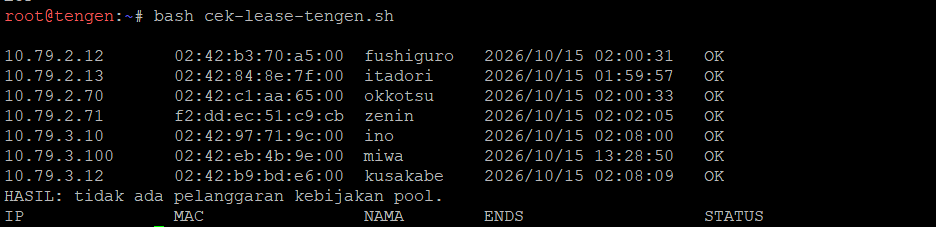

Dari gambar tersebut terlihat setiap alamat aktif berstatus OK. IP dan MAC pada tabel sama dengan hasil cek-klien.sh, kedelapan alamat berbeda satu sama lain, dan tidak ada alamat pada rentang 10.79.2.36 sampai 10.79.2.69 maupun 10.79.3.90 sampai 10.79.3.98. Kugisaki dapat tidak muncul pada dhcpd.leases, sehingga alamat 10.79.3.99 dibuktikan lewat reservasi pada hosts.conf dan output klien.

**8. Sebelum Curtain dibuka kembali, buktikan bahwa proses pemberian alamat berjalan sesuai protokol. Lakukan packet capture saat salah satu client Network 2 atau Network 3 meminta lease baru. Gunakan tcpdump pada tengen atau jalur menuju Data Center untuk menunjukkan urutan DHCPDISCOVER → DHCPOFFER → DHCPREQUEST → DHCPACK. Identifikasi alamat server, alamat yang diberikan, lease time, dan field giaddr. Pastikan nilai giaddr sesuai dengan interface jichi yang menerima request dari subnet client.**

Jadi pertama-tama melakukan capture pada node tengen ketika salah satu client di network 2 atau network 3 melakukan request lease baru.
Capture dilakukan dengan tcpdump. Pertama-tama kita install dulu:

```sh
apt install -y tcpdump
```

Kemudian capture dijalankan sekaligus akan disimpan ke soal-8.pcap dengan command berikut ini.

```sh
tcpdump -i eth0 -n -v -e port 67 or port 68 -w /root/soal-8.pcap
```

Kemudian saat capture sudah berjalan, dari sisi client dilakukan request lease baru dengan command berikut.

```sh
bash soal-4-bukti.sh 
```

Setelah itu kita kembali ke node tengen, disitu akan terlihat bahwa sudah ada paket yg tercapture. Kita hentikan proses capture dgn `ctrl+c`, setelah itu kita bisa melihat hasil capture yang telah dilakukan.

```sh
tcpdump -n -vvv -r /root/soal-8.pcap
```

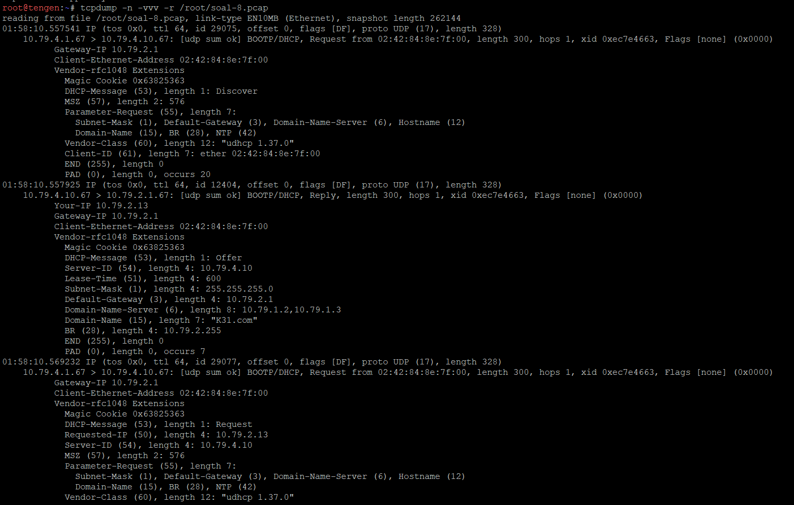

Dari paket tersebut dapat dilihat proses dari DHCP yang dimulai dari Discover -> Offer -> Request -> ACK. Kemudian untuk analisis alamat server, alamat yang diberikan, lease time, dan giaddr adalah sebagai berikut.

- **Alamat server:** `10.79.4.10` (tengen), dari `Server-ID (54)` pada Offer dan ACK.
- **Alamat yang diberikan:** `10.79.2.13`, dari `Your-IP` pada Offer dan ACK. Alamat ini berada di rentang Pool 1 (`10.79.2.10` sampai `10.79.2.35`).
- **Lease time:** `600` detik, dari `Lease-Time (51)`. Pool 1 memakai `default-lease-time` global.
- **giaddr:** `10.79.2.1`, dari `Gateway-IP` pada keempat paket.

eth2 bernilai `10.79.2.1/24` dan Itadori berada di Network 2, sehingga Discover-nya diterima relay di eth2 dan `giaddr` diisi `10.79.2.1`, sama dengan `Gateway-IP` pada capture.

**9. Sebuah gangguan memutus jalur relay dan membuat permintaan alamat tidak sampai ke Data Center. Hentikan service DHCP Relay pada jichi, lalu paksa salah satu client di Network 2 atau Network 3 meminta lease baru dan catat gejalanya. Pulihkan service relay, ulangi permintaan DHCP, lalu buktikan bahwa client kembali memperoleh alamat dari pool yang benar dengan gateway semula.**

Jadi kita diminta untuk mematikan service dhcp relay, kemudian melakukan request lease di salah satu client untuk mengamati dan mencatat gejalanya. 

Pertama-tama kita stop service dhcp relay pada node jichi.
```sh
service isc-dhcp-relay stop
ps aux | grep [d]hcrelay
```

Kemudian kita menjalankan tcpdump di node jichi dan tengen untuk mencatat gejalanya.

```
tcpdump -i eth2 -n port 67 or port 68 # tengen
tcpdump -i eth0 -n port 67 or port 68 # jichi 
```

Setelah tcpdump berjalan, selanjutnya melalui salah satu klien yaitu node itadori, kita melakukan request lease baru.

```sh
bash soal-4-bukti.sh
```


Dari gambar tersebut dilihat bahwa permintaan lease baru gagal karena service dhcp relay dihentikan.

Setelah melakukan request lease baru, selanjutnya mencatat dan mengamati gejala dari langkah yang sudah dilakukan.

Pada node tengen, tcpdump tidak menangkap paket apapun.

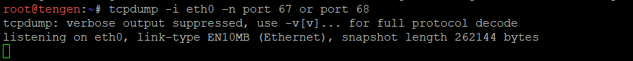

Sementara pada node jichi, hasil tcpdump menangkap paket request namun tidak ada reply yang dikembalikan.

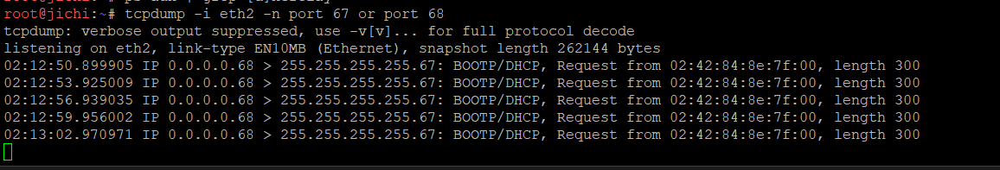

Selanjutnya kita menyalakan ulang service dhcp relay dan mengulangi kembali langkah yang sudah kita lakukan sebelumnya. 

```sh
service isc-dhcp-relay start
ps aux | grep [d]hcrelay
```

Kemudian melakukan tcpdump melalui node Tengen dan jichi.

```
tcpdump -i eth2 -n port 67 or port 68 # tengen
tcpdump -i eth0 -n port 67 or port 68 # jichi 
```

Setelah tcpdump berjalan, selanjutnya melalui salah satu klien yaitu node itadori, kita melakukan request lease baru.

```sh
bash soal-4-bukti.sh
```

Dari gambar tersebut dilihat bahwa permintaan lease baru berhasil karena service dhcp relay telah dinyalakan kembali. Itadori kembali memperoleh alamat 10.79.2.13 dari 10.79.4.10 dengan gateway 10.79.2.1. Alamat ini berada di rentang Pool 1 (10.79.2.10 sampai 10.79.2.35), dan DNS serta domain-search juga diterima kembali.

Setelah melakukan request lease baru, selanjutnya mencatat dan mengamati gejala dari langkah yang sudah dilakukan.

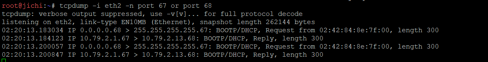

Pada capture di jichi setelah pemulihan menunjukkan pola berbeda dari saat relay mati. Setiap Discover dari itadori kini dijawab Reply dari 10.79.2.1, yaitu relay di eth2 yang meneruskan Offer dan ACK dari tengen ke klien. Proses DORA berlangsung lengkap.

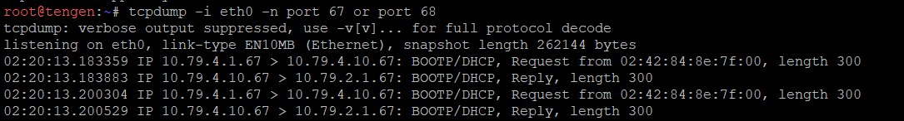

Semntara capture di tengen setelah relay dipulihkan menunjukkan transaksi DHCP itadori. Discover dan Request tiba dari 10.79.4.1 (eth4 jichi) ke 10.79.4.10, sedangkan Offer dan ACK dikirim tengen ke 10.79.2.1 (eth2 jichi), sehingga terbukti permintaan klien Network 2 kembali diteruskan oleh relay.

**10. Setelah gangguan Shibuya tertangani, pastikan pemulihan bertahan setelah restart. Aktifkan autostart DHCP Server pada tengen dan DHCP Relay pada jichi, lalu restart kedua node. Verifikasi status layanan, IP, gateway, lease, dan konektivitas client Network 2–3. Pastikan kebijakan Pool 1, Pool 2, short lease, long lease, dan fixed address tetap berlaku.**

Pertama-tama pada node tengen, baris up service isc-dhcp-server start ditambahkan di bawah gateway. 

```sh
grep -q 'service isc-dhcp-server start' /etc/network/interfaces || \
sed -i '/^    gateway 10.79.4.1/a\    up service isc-dhcp-server start' /etc/network/interfaces
cat /etc/network/interfaces
```

Pada node jichi, baris up service isc-dhcp-relay start ditaruh di blok eth4 (interface terakhir) agar eth2, eth3, dan eth4 sudah punya IP saat relay dijalankan.

```sh
grep -q 'service isc-dhcp-relay start' /etc/network/interfaces || \
sed -i '/^    address 10.79.4.1/a\    up service isc-dhcp-relay start' /etc/network/interfaces
cat /etc/network/interfaces
```

Di GNS3, jichi kemduain tengen di-Stop dan di-Start kembaki. 

Selanjutnya setelah kedua node berhasil menyala kembali, verifikasi layanan setelah restart.

Di tengen:

```sh
date
service isc-dhcp-server status
ps aux | grep [d]hcpd
ip -4 a show eth0
ip route
dhcpd -t -cf /etc/dhcp/dhcpd.conf
```

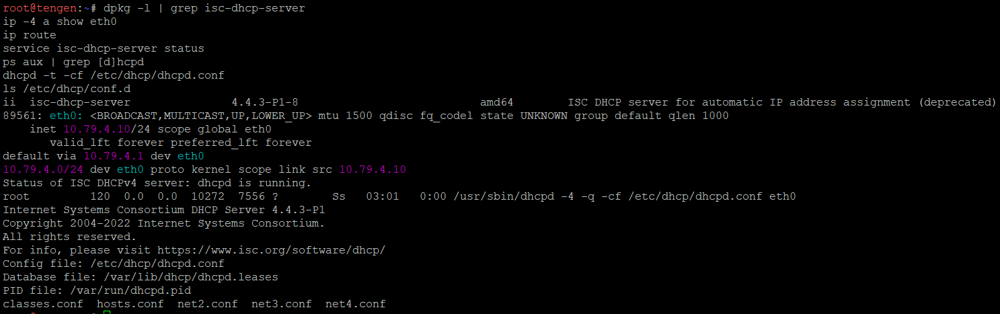

dhcpd is running dengan proses yang mulai saat boot, eth0 bernilai 10.79.4.10/24, default via 10.79.4.1, dan dhcpd -t lolos tanpa error.

Di jichi:

```sh
date
ps aux | grep [d]hcrelay
ip -4 a
cat /proc/sys/net/ipv4/ip_forward
iptables -t nat -L POSTROUTING -n
ping -c 2 10.79.4.10
```

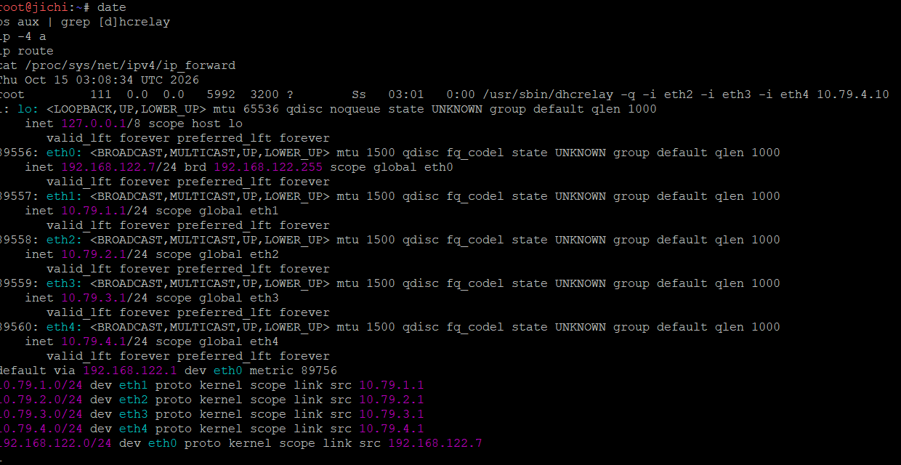

Proses dhcrelay -q -i eth2 -i eth3 -i eth4 10.79.4.10 berjalan sejak boot, IP eth1 sampai eth4 sudah sesuai, ip_forward bernilai 1, aturan MASQUERADE ada, dan ping ke tengen berhasil. 

Langkah selanjutnya memverifikasi bahwa kebijakan tetap berlaku.

Isi konfigurasi di tengen diperiksa untuk memastikan tidak berubah oleh restart.

```sh
cat /etc/dhcp/dhcpd.conf /etc/dhcp/conf.d/*.conf
```

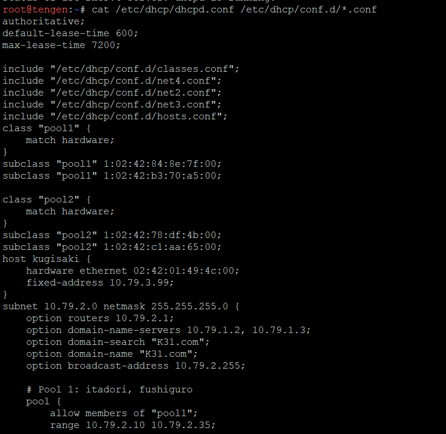

Seluruh kebijakan masih ada: class pool1 dan pool2 dengan range 10.79.2.10-.35 dan 10.79.2.70-.95, class short-lease (1800 detik, 10.79.3.10-.89) dan long-lease (43200 detik, 10.79.3.100-.199), reservasi kugisaki 10.79.3.99, serta DNS 10.79.1.2, 10.79.1.3 dan domain K31.com.

Selanjutnya memverifikasi bahwa kebijakan yang telah diterapkan di klien masih berlaku.

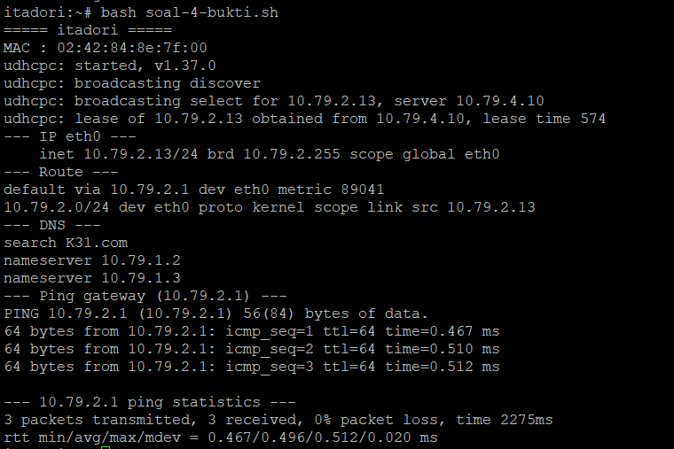

Dilakukan pengujian di salah satu klien network 2 yaitu Itadori. Dapat dilihat bawah itadori mendapatkan rentang sesuai dengan kebijakan yang telah diterapkan yaitu di rentang .10-.35 (Pool 1).

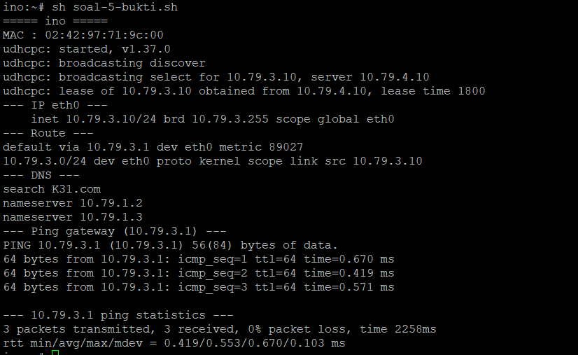

Kemudian, dilakukan juga pengujian di salah satu klien network 3 yaitu Ino. Dapat dilihat bawah Ino mendapatkan rentang sesuai dengan kebijakan yang telah diterapkan yaitu di rentang .10-.89 dengan lease time 1800.

**11. utahime dan shoko ditugaskan membangun sistem penamaan domain resmi agar seluruh pos tidak perlu menghafal alamat IP mentah. Konfigurasikan BIND9 pada utahime sebagai DNS Master dan shoko sebagai DNS Slave untuk mengelola domain jujutsu.< xxxx>.com. Atur SOA record, NS delegasi untuk kedua server, dan terapkan allow-transfer dari Master ke Slave. Pastikan file zona berhasil tersinkronisasi otomatis ke shoko saat nomor serial di utahime dinaikkan, lalu buktikan dengan melakukan query dig ke kedua server dari salah satu client.**

Setup pada utahime sebagai DNS Master, seperti berikut: <br>
Pada /etc/bind/named.conf.local, tambahkan

```sh
zone "jujutsu.K31.com" {
        type master;
        file "/etc/bind/db.jujutsu.K31.com";
        allow-transfer { 10.79.1.3; };
        also-notify { 10.79.1.3; };
};
```
Pada /etc/bind/db.jujutsu.K31.com, tambahkan

```sh
$TTL    86400
@       IN      SOA     utahime.jujutsu.K31.com. admin.jujutsu.K31.com. (
                2026101401
                3600
                1800
                604800
                86400
)

@       IN      NS      utahime.jujutsu.K31.com.
@       IN      NS      shoko.jujutsu.K31.com.

utahime IN      A       10.79.1.2
shoko   IN      A       10.79.1.3
@       IN      A       10.79.1.2

```

Cek dan reload

```sh
named-checkconf
named-checkzone jujutsu.K31.com /etc/bind/db.jujutsu.K31.com

service named restart
service named status
```
Setup pada shoko sebagai DNS Slave dan utahime sebagai masternya: <br>
Pada /etc/bind/named.conf.local, tambahkan

```sh
zone "jujutsu.K31.com" {
        type slave;
        masters { 10.79.1.2; }
        file "/var/cache/bind/db.jujutsu.K31.com";
}
```
Cek dan reload

```sh
named-checkconf

service named restart
service named status
```

Buktikan menggunakan query dig:
- dig @10.79.1.2 jujutsu.K31.com SOA
- dig @10.79.1.2 jujutsu.K31.com NS
- dig @10.79.1.3 jujutsu.K31.com SOA
- dig @10.79.1.3 jujutsu.K31.com NS
- dig @10.79.1.3 jujutsu.K31.com 


<br> 

**12. Peta domain harus memetakan pintu masuk utama dan tetap bisa mencari alamat di luar kawasan Shibuya. Pada utahime, buat A record jujutsu.< xxxx>.com yang mengarah ke gojo, serta CNAME www yang merujuk ke domain utama tersebut. Buat pula Reverse DNS (zona PTR) untuk melacak IP gojo kembali ke domain resminya, dan aktifkan fitur DNS Forwarder pada BIND9 mengarah ke IP gateway internet (192.168 122.1). Uji dari client dengan dig untuk mengecek CNAME, PTR, dan buktikan client tetap bisa melakukan ping ke domain internet seperti google.com.**

Setup CNAME dengan mengubah dan menambahkan berikut pada /etc/bind/db.jujutsu.K31.com milik DNS Master (utahime):

```sh
$TTL    86400
@       IN      SOA     utahime.jujutsu.K31.com. admin.jujutsu.K31.com. (
                2026101403
                3600
                1800
                604800
                86400
)

@       IN      NS      utahime.jujutsu.K31.com.
@       IN      NS      shoko.jujutsu.K31.com.

utahime IN      A       10.79.1.2
shoko   IN      A       10.79.1.3
@       IN      A       10.79.1.4    // ubah

www     IN      CNAME   jujutsu.K31.com.  //tambahkan
```
Cek dan reload

```sh
named-checkconf
named-checkzone jujutsu.K31.com /etc/bind/db.jujutsu.K31.com
rndc reload jujutsu.K31.com
```

Setup Reverse DNS (zona PTR) untuk melacak IP gojo kembali ke domain resminya:
<br>
Pada /etc/bind/named.conf.local, tambahkan

```sh
zone "1.79.10.in-addr.arpa" {
        type master;
        file "/etc/bind/db.10.79.1";
        allow-transfer { 10.79.1.3; };
        also-notify { 10.79.1.3; };
};
```

dan pada /etc/bind/db.10.79.1, tambahkan

```sh
$TTL    86400
@       IN      SOA     utahime.jujutsu.K31.com. admin.jujutsu.K31.com. (
        2026101401
        3600
        1800
        604800
        86400
)

@       IN      NS      utahime.jujutsu.K31.com.
@       IN      NS      shoko.jujutsu.K31.com.
4       IN      PTR     jujutsu.K31.com.
```

Cek dan reload

```sh
named-checkconf && named-checkzone jujutsu.K31.com /etc/bind/db.jujutsu.K31.com &&  named-checkzone 1.79.10.in-addr.arpa /etc/bind/db.10.79.1
rndc reload
```

Aktifkan fitur DNS Forwarder pada BIND9 mengarah ke IP gateway internet (192.168 122.1), dengan menamabahkan pada options lalu cek dan reload

```sh
nano /etc/bind/named.conf.options

        forwarders {
                192.168.122.1;
        };

named-checkconf
rndc reload
```

Uji dari client menggunakan dig untuk mengecek CNAME, PTR, dan ping ke google.com

- dig @10.79.1.2 www.jujutsu.K31.com CNAME
- dig @10.79.1.2 -x 10.79.1.4
- dig @10.79.1.2 google.com A

<br>

**13. Kepala Sekolah Yaga dan Inumaki mendirikan database terpusat yang redundan agar log aktivitas kutukan tetap aman tersimpan. Konfigurasikan MariaDB pada yaga sebagai DB-Master dan inumaki sebagai DB-Slave. Buat database db_shibuya _< xxxx> beserta tabel request_logs di Master, aktifkan binary logging (log-bin, server-id), lalu hubungkan inumaki sebagai Slave yang menyalin data secara realtime dengan CHANGE MASTER TO. Berikan hak akses remote bagi seluruh node di Network 4, lalu buktikan replikasi berhasil dengan memasukkan data baru di Master dan memeriksa hasilnya di Slave.**

```sh
apt-get update
apt-get install -y mariadb-server mariadb-client
```

Setup DB Master pada yaga dengan menambahkan ini pada /etc/mysql/mariadb.conf.d/60-replication.cnf lalu reload

```sh
[mysqld]
server-id = 4
log_bin = /var/log/mysql/mariadb-bin
binlog_format = ROW
bind-address = 0.0.0.0

service mariadb restart
```

Cek, debug, dan reload

```sh
mkdir -p /var/log/mysql
chown mysql:mysql /var/log/mysql
chmod 750 /var/log/mysql
service mariadb restart
mariadb -e "SHOW VARIABLES LIKE 'server_id';"
mariadb -e "SHOW VARIABLES LIKE 'log_bin';"
mariadb -e "SHOW MASTER STATUS\G"
```

Setup DB Slave pada inumaki dengan menambahkan ini pada /etc/mysql/mariadb.conf.d/60-replication.cnf lalu reload

```sh
[mysqld]
server-id = 5
relay_log = /var/log/mysql/mariadb-relay-bin
bind-address = 0.0.0.0
```

Cek, debug dan reload

```sh
mkdir -p /var/log/mysql
chown mysql:mysql /var/log/mysql
chmod 750 /var/log/mysql
service mariadb restart
mariadb -e "SHOW VARIABLES LIKE 'server_id';"
mariadb -e "SHOW VARIABLES LIKE 'relay_log';"
```

Membuat database "db_shibuya_K31" pada DB Master (yaga)

```sql
CREATE DATABASE IF NOT EXISTS db_shibuya_K31;

USE db_shibuya_K31;

CREATE TABLE IF NOT EXISTS request_logs (
        id INT AUTO_INCREMENT PRIMARY KEY,
        request_method VARCHAR(10) NOT NULL,
        request_path VARCHAR(255) NOT NULL,
        status_code INT,
        created_at TIMESTAMP DEFAULT CURRENT_TIMESTAMP
);
```

Cek tabel pada database "db_shibuya_K31"

```sh
mariadb -e "SHOW TABLES FROM db_shibuya_K31;"
```

Setup user replikasi di server master, aktifkan binary logging dan mengecek database yang di replikasi (yaga)

```sql
CREATE USER IF NOT EXISTS 'repl'@'10.79.4.2'
IDENTIFIED BY 'ReplLab2026!';
GRANT REPLICATION SLAVE ON *.* TO 'repl'@'10.79.4.2’;
FLUSH PRIVILEGES;
SHOW MASTER STATUS\G

SHOW DATABASES LIKE 'db_shibuya_K31';
SHOW TABLES FROM db_shibuya_K31;
```

Menghubungkan slave ke master dan memulai replikasi database
(inumaki)

```sql
STOP SLAVE;
CHANGE MASTER TO
    MASTER_HOST='10.79.4.9',
    MASTER_USER='repl',
    MASTER_PASSWORD='ReplLab2026!',
    MASTER_PORT=3306,
    MASTER_LOG_FILE='mariadb-bin.000001',
    MASTER_LOG_POS=1511; (tergantung master)
START SLAVE;
SHOW SLAVE STATUS\G
```

Pengujian replikasi secara realtime<br>
Di yaga:

```sql
CREATE TABLE IF NOT EXISTS db_shibuya_K31.replication_test (
    id INT AUTO_INCREMENT PRIMARY KEY,
    pesan VARCHAR(100)
);

INSERT INTO db_shibuya_K31.replication_test (pesan)
VALUES ('Tes replikasi realtime');
```
Di inumaki:

```sql
SHOW TABLES FROM db_shibuya_K31;

SELECT * FROM db_shibuya_K31.replication_test;
```

Memberikan hak akses pada seluruh node di Network 4

```sql
CREATE USER IF NOT EXISTS 'remote_user'@'10.79.4.%'
IDENTIFIED BY 'RemoteLab2026!';

ALTER USER 'remote_user'@'10.79.4.%'
IDENTIFIED BY 'RemoteLab2026!';

GRANT ALL PRIVILEGES ON db_shibuya_K31.*
TO 'remote_user'@'10.79.4.%';

SHOW GRANTS FOR 'remote_user'@'10.79.4.%';
```

Cek pada inumaki

```sql
mariadb -h 10.79.4.9 -u remote_user -p db_shibuya_K31

// Masukkan password RemoteLab2026!. Kalau udah masuk verifikasi akses:

SHOW TABLES;
SELECT * FROM replication_test;
```

**14. Para penyihir lapangan bersiaga di Data Center sebagai pekerja backend untuk memproses aplikasi. Pasang Nginx dan PHP-FPM pada maki dan panda untuk menyajikan web frontend yang menampilkan hostname masing-masing. Pada nanami, todo, dan kirara, siapkan layanan API yang mencatat log request ke database yaga. Konfigurasikan virtual host agar worker merespons domain layanan yang ditentukan. Batasi akses langsung dari klien ke worker, web worker hanya menerima trafik melalui jalur proxy web yang ditentukan, sedangkan worker API hanya menerima trafik melalui geto. Uji bahwa akses langsung dari klien ditolak, sementara akses melalui reverse proxy tetap berhasil.**


**15. Geto bertugas mengendalikan pembagian beban request API di internal Data Center agar server tidak tumbang bersamaan. Konfigurasikan Nginx pada geto sebagai Load Balancer internal dengan upstream api_cluster yang mengarahkan trafik ke nanami dan todo. Terapkan algoritma Weighted Round Robin dengan bobot 3:1, di mana nanami menerima porsi beban tiga kali lebih banyak daripada todo. Buktikan distribusi beban ini dengan melakukan loop request berulang kali ke geto dari jaringan lokal Data Center dan periksa rasio responnya.**

**16. Gojo berdiri di perbatasan DMZ sebagai gerbang publik tunggal bagi seluruh client dari luar maupun dalam. Konfigurasikan Nginx pada gojo untuk melayani domain jujutsu. < xxxx>.com dan www.jujutsu .< xxxx>.com menggunakan metode Path-Based Routing. Atur agar request root (/) diteruskan secara Round Robin ke worker frontend (maki dan panda), sedangkan request ke path /api diteruskan langsung ke geto. Uji dari client Divisi A atau B bahwa akses ke web utama dibalas oleh Maki/Panda, sedangkan akses ke  api diteruskan dan dijawab oleh Nanami/Todo.**

**17. Komando pusat perlu mengetahui IP asli klien yang mengirimkan request tanpa tertukar dengan IP proxy perantara. Konfigurasikan gojo dan geto agar meneruskan informasi alamat klien melalui header X-Real-IP dan X-Forwarded-For. Pastikan geto hanya mempercayai informasi alamat klien yang diterima dari proxy terpercaya, dan skrip API menyimpan alamat klien yang telah diverifikasi ke kolom client_ip pada tabel request_logs di database yaga. Uji dengan mengirimkan request dari klien Network 2 dan Network 3 ke endpoint /api, kemudian periksa database untuk memastikan alamat yang tercatat sesuai dengan IP klien asal, bukan IP gojo atau geto.**

**18. nanami dan todo merupakan worker API utama, sedangkan kirara disiapkan sebagai  worker cadangan. Konfigurasikan upstream api_cluster pada geto agar kirara menjadi server backup, serta terapkan passive health check dengan parameter max_fails=2 dan fail_timeout=5s pada worker API utama. Pastikan kirara menjalankan layanan API yang kompatibel dengan endpoint utama. Simulasikan gangguan dengan menghentikan layanan Nginx atau layanan API pada nanami dan todo. Buktikan dari klien bahwa request ke /api dialihkan ke kirara dan menghasilkan respons API yang valid tanpa error 502 Bad Gateway.**

**19. gojo bertugas mengoptimalkan layanan web sekaligus membatasi request berlebihan. Konfigurasikan Nginx Proxy Caching untuk halaman web frontend dengan masa berlaku cache 10 menit dan tambahkan header X-Cache-Status. Terapkan rate limiting pada path /api dengan batas 10 request per detik per IP klien. Buktikan bahwa request ke halaman web yang memenuhi syarat cache menghasilkan status MISS pada akses awal dan HIT pada akses berikutnya. Uji rate limiting secara terpisah dengan mengirimkan request beruntun ke /api, kemudian catat status respons yang dihasilkan ketika batas terlampaui.**

**20. Sebelum Curtain di Shibuya resmi dibuka,  Kusakabe memimpin audit untuk menguji kapasitas layanan. Dari terminal kusakabe, jalankan benchmark menggunakan Apache Benchmark dengan parameter -n 600 -c 30 menuju http://jujutsu .< xxxx>.com/. Catat Requests per Second (RPS), latensi, dan jumlah request yang gagal. Lakukan pengujian tambahan pada endpoint /api untuk mengamati efek rate limiting. Bandingkan hasil pengujian baseline dengan hasil ketika rate limiting aktif, serta gunakan access log gojo untuk membedakan kegagalan aplikasi, koneksi, dan request yang ditolak oleh kebijakan rate limit.**